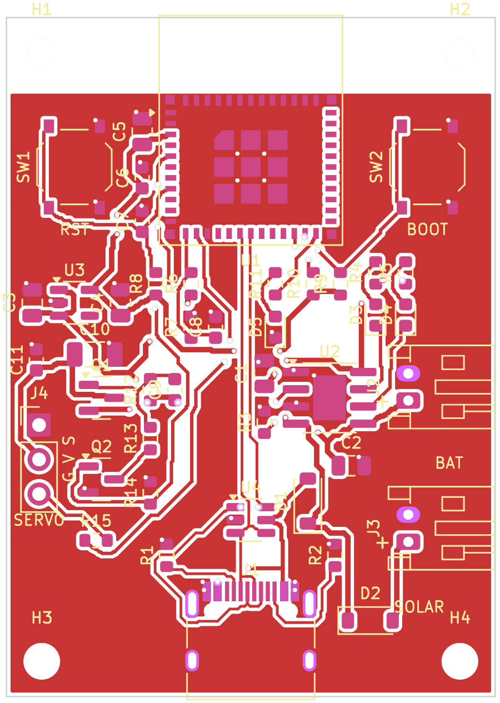
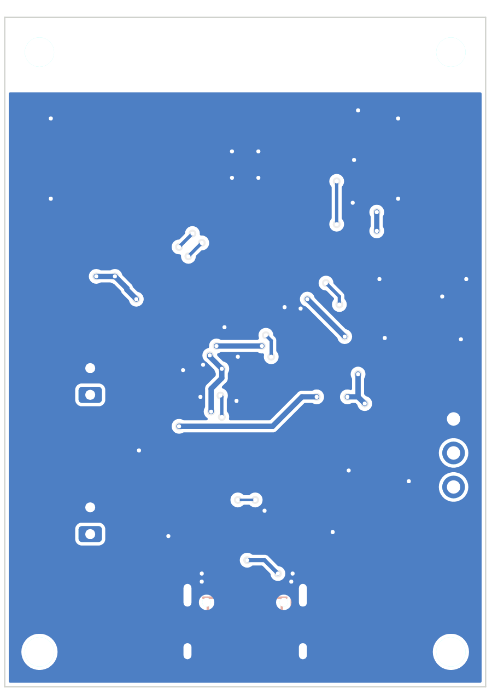

# Vent Control – eigen printplaat (ESP32-C6, zonnepaneel, LiPo, servo)

Een compacte printplaat (**36 × 50 mm, 2 lagen**) die de FireBeetle 2 ESP32-C6 + losse
bedrading vervangt. Alles wat je nu met losse onderdelen doet, zit op de print:
de Schottky-diode voor het zonnepaneel, en de MOSFET + weerstanden die de servo-voeding schakelen.

| Bovenkant | Onderkant (gespiegeld) |
|---|---|
|  |  |

Schema: [production/vent-control-schematic.pdf](production/vent-control-schematic.pdf)

## Wat zit erop

| Blok | Onderdelen | Opmerking |
|---|---|---|
| MCU | **ESP32-C6-MINI-1-N4** (U1) | Thread/Matter, WiFi 6, BLE. PCB-antenne aan de bovenrand; onder de antenne is een kopervrije zone van 5,6 mm. |
| USB-C | J1 + USBLC6-2SC6 (ESD) + 2× 5,1 kΩ CC | Flashen/loggen via de ingebouwde USB-Serial/JTAG (GPIO12/13) en opladen. |
| Zonnepaneel | J3 (JST-PH 2p) + **D2 B5819W Schottky** | USB (D1) en zonnepaneel (D2) zijn via diodes "ge-OR'd" naar de lader. 5–6 V paneel. |
| Lader | **TP4056** (U2), 500 mA (R3 = 2,4 kΩ) | Rode LED = laden, groene LED = vol. Max. ingangsspanning 8 V, dus een 6 V-paneel (Voc ≈ 7 V) is OK. |
| Batterij | J2 (JST-PH 2p), 1S LiPo | **Gebruik een cel mét beveiligingsprintje** (de TP4056 heeft geen onderspanningsbeveiliging). |
| 3,3 V | **XC6220B331MR** LDO (U3) | 1 A, ruststroom ±8 µA, lage dropout. |
| Batterijmeting | 1 MΩ / 1 MΩ + 100 nF → **GPIO0** | Zelfde als de FireBeetle (`multiply: 2.0`). Kost permanent ~2 µA. |
| Servo-voeding | **Q1 AO3401A** (P-FET) + **Q2 2N7002** + R12/R13/R14/C9 | **GPIO2** hoog = servo aan. In deep sleep is de servo volledig spanningsloos. R13/C9 geven een soft-start (~1 ms) tegen inschakelpieken; R14 houdt de servo uit tijdens reset/slaap. 47 µF + 100 nF buffer. |
| Servo | J4 (3-pin header, G-V-S) | Signaal op **GPIO1** via 1 kΩ. Servo (SG90/MG90 360°) draait direct op de accuspanning 3,0–4,2 V. |
| Knoppen/LED | RESET (EN), BOOT (GPIO9), status-LED (**GPIO18**) | GPIO8 heeft de verplichte pull-up voor het opstarten. |

### Pinnen samengevat

| Functie | GPIO | Verschil met FireBeetle-versie |
|---|---|---|
| Servo signaal | GPIO1 | zelfde |
| Batterijspanning (ADC, ×2) | GPIO0 | zelfde |
| Servo voeding aan/uit | GPIO2 | **nieuw** |
| Status-LED | GPIO18 | was GPIO15 ("Battery Measure Enable", dat was in feite de LED) |
| USB D-/D+ | GPIO12/13 | intern |

## Firmware

Gebruik [`../ventcontrol-pcb.yaml`](../ventcontrol-pcb.yaml) (gevalideerd met `esphome config`, ESPHome 2026.10.2).
De scripts zetten nu eerst de servo-voeding aan (GPIO2), bewegen de servo, stoppen,
en schakelen de voeding weer uit. Het apparaat gaat pas slapen als een servo-beweging klaar is.
De originele `ventcontrol.yaml` (FireBeetle) is ongewijzigd.

## Bestellen bij JLCPCB

1. **PCB**: upload `production/vent-control-gerbers.zip`. 2 lagen, 1,6 mm, standaard instellingen.
2. **PCB Assembly** (bovenkant): upload `production/bom-jlcpcb.csv` en `production/cpl-jlcpcb.csv`.
3. Controleer in de BOM-stap **elk onderdeel** (zie hieronder) en in de preview de **rotatie**
   van de onderdelen (vooral U1, U2, U3, U4, Q1, Q2, J1, de LEDs en dioden). JLCPCB's
   bibliotheek gebruikt soms een andere nul-rotatie dan KiCad; dat corrigeer je in de preview.
4. Zelf solderen (doorsteek): J2 + J3 (JST S2B-PH-K-S, liggend) en J4 (1×3 header).

### Let op: LCSC-nummers niet geverifieerd

Vanuit deze omgeving kon ik de catalogus van LCSC/JLCPCB niet bereiken. De LCSC-nummers in de BOM
zijn uit mijn kennis ingevuld en **moeten gecontroleerd worden**. Voor deze onderdelen moet je zelf een
nummer kiezen (zoek op MPN):

| Ref | Onderdeel |
|---|---|
| U1 | ESP32-C6-MINI-1-N4 (Espressif) |
| U3 | XC6220B331MR-G (Torex), of een pin-compatibele low-Iq LDO (SOT-23-5: VIN, GND, CE, NC, VOUT) |
| C10 | 47 µF 1206 ≥ 6,3 V X5R |
| R3 | 2,4 kΩ 0603 (bepaalt de laadstroom: I ≈ 1200 / R3) |

## ⚠️ Belangrijk vóór gebruik

* **Polariteit JST-batterij!** JST-PH-accu's hebben géén vaste kleurconventie. Op de print is
  **pin 1 = + (vierkante pad, "+" in de silkscreen)**. Controleer dit met een multimeter vóór je inplugt.
  Een omgekeerde accu beschadigt de lader en de LDO (er zit geen ompoolbeveiliging op).
* **Laadstroom 500 mA**: geschikt voor accu's vanaf ±500 mAh. Bij een kleinere accu R3 verhogen
  (bijv. 4,7 kΩ ≈ 250 mA).
* De TP4056 heeft geen MPPT. Voor een klein paneel (≤ 2 W) werkt dat prima.
* De ESP32 hangt direct aan de accu (geen "load sharing"). Omdat het apparaat bijna altijd slaapt,
  is dat geen probleem voor het laadeinde.
* Houd metaal en batterij weg van de antennezone (bovenste 5,6 mm) in de behuizing.
* **Verwacht slaapverbruik (geschat, niet gemeten)**: ESP32-C6 deep sleep (~7 µA), LDO (~8 µA),
  spanningsdeler (~2 µA), lader/lekstroom (enkele µA). Dat is totaal ordegrootte 20 µA.
  De servo trekt niets meer.

## Hoe dit ontwerp gemaakt en gecontroleerd is

Alles wordt gegenereerd uit één bestand, [`generator/design.py`](generator/design.py) (onderdelen + netten):

```
generator/build.sh      # draait alle stappen hieronder (KiCad 7 nodig)
  gen_lib.py            # projectsymbolen (ESP32-C6-MINI-1, TP4056) + module-footprint
  gen_sch.py            # schema (kicad/vent-control.kicad_sch)
  check_sch.py          # exporteert de netlist met kicad-cli en vergelijkt met design.py
  route.py              # plaatsing (gen_pcb.py) + eigen A*-router (2 lagen, 0/45/90°)
  finish_pcb.py         # GND-vlakken op beide lagen + KiCad DRC
  export.py             # Gerbers, boorbestanden, BOM, CPL, PDF's
```

Uitgevoerde controles:

* **Schema ↔ ontwerp**: de door KiCad geëxporteerde netlist komt exact overeen
  (27 netten, 47 componenten; geen enkelvoudige netten, voedingsingangen gevoed).
  Let op: `kicad-cli` van KiCad 7 heeft nog geen ERC, dus dit is een eigen controle i.p.v. KiCad's ERC.
  Open het schema in KiCad en draai ERC voor een tweede mening.
* **PCB ↔ ontwerp**: alle 145 pin-net-toewijzingen op de PCB gecontroleerd.
* **KiCad DRC: 0 fouten, 0 onverbonden** ([drc-report.txt](production/drc-report.txt)).
  De overgebleven meldingen zijn waarschuwingen: silkscreen die over pads/rand valt (wordt door de
  fabrikant weggeknipt), en "lib_footprint_issues" omdat de footprint-bibliotheek in headless modus
  niet geladen is.
* Regels: spoor ≥ 0,2 mm (signaal 0,25, voeding 0,4), clearance 0,2 mm, via 0,6/0,3 mm. Dat valt ruim binnen
  de standaard JLCPCB-specificaties.

De footprint van de ESP32-C6-MINI-1 is omgezet uit de officiële KiCad-bibliotheek
(`lib/upstream/`, KiCad 10-formaat, CC-BY-SA 4.0 met uitzondering) naar KiCad 7-formaat.
De padgeometrie is 1-op-1 overgenomen.

**Dit ontwerp is niet fysiek getest.** Bestel eerst een kleine serie (5 stuks) en meet bij de
eerste print de 3,3 V, de laadfunctie en het slaapverbruik voordat je er meer maakt.
